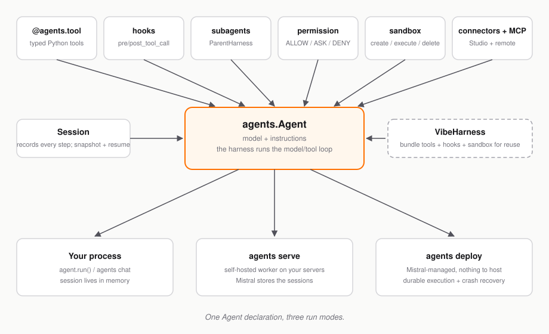

# The Agents SDK Walkthrough: Ten Steps to a Production Agent

## Overview

With the [Agents SDK](https://pypi.org/project/mistralai-agents/) (`mistralai-agents`), an agent is a Python object: a model plus instructions, wired to tools, a sandbox, connectors, and controls. The SDK's harness drives the model-and-tool loop and records every step in a session. The same code runs in your process for development, self-hosted with `agents serve`, or Mistral-managed with `agents deploy`.

This walkthrough ports an interactive offline demo into ten copy-paste steps. Every snippet builds on one running example - a travel agent - so each capability layers onto the last.

### Prerequisites

- Python 3.12+ and [`uv`](https://docs.astral.sh/uv/) (or pip)
- Basic async Python (`async`/`await`); snippets that use `await` run inside an `async def main()`

### What You'll Learn

- Run a one-shot agent with `agents.Agent` and `agent.run()`
- Attach tools with `@agents.tool` and bundle them in a `VibeHarness`
- Intercept every tool call with hooks (`pre_tool_call`, `post_tool_call`, `on_event`)
- Get typed Pydantic objects back via `response_format`
- Delegate to subagents with `ParentHarness`
- Gate dangerous tool calls with ALLOW / ASK / DENY permission rules
- Persist multi-turn memory in sessions with snapshot and resume
- Execute code in a sandbox (create, execute, delete)
- Serve and deploy with `agents serve` / `agents deploy` and `to_workflow()`
- Compose all of it into one production-grade agent declaration

### What You'll Need

- A [Mistral account](https://auth.mistral.ai/ui/login) - free tier works
- An API key from the [Mistral Console](https://console.mistral.ai/) (**API Keys** > *Create new key* - shown only once), exported as `MISTRAL_API_KEY`
- The SDK installed: `uv add mistralai-agents` (or `pip install mistralai-agents`)

### What You'll Build

A production-shaped travel agent: typed tools, observability hooks, subagents, a human approval gate on bookings, session memory, a code sandbox, and a one-command deploy - all declared in one `agents.Agent(...)`.



Set up a project to paste the snippets into:

```bash
uv init --python 3.12 travel-agent && cd travel-agent
uv add mistralai-agents
export MISTRAL_API_KEY="<your-key>"
```

## Part 1 - Your First Agent

### Run a One-Shot Agent

The simplest form: an `Agent` with just `model` and `instructions`. Call `agent.run(prompt)` and get a `RunResult` back.

```python
import asyncio

from mistralai import agents

agent = agents.Agent(
    model="mistral-medium-3-5",
    instructions="You are a travel advisor.",
)
result = asyncio.run(agent.run("Top things in Tokyo?"))
print(result.text)         # the agent's response
print(result.stop_reason)  # "completed"
```

Try it: ask "What are the top 3 things to do in Tokyo?" and the agent answers with Senso-ji Temple, Shibuya Crossing and Harajuku, and Tsukiji Outer Market.

Checkpoint: one object, one call, one answer - the whole agent loop ran in your process.

### Add Tools with a Harness

Tools are plain Python functions decorated with `@agents.tool`; the SDK auto-generates the schema from the signature and docstring. `VibeHarness` bundles tools + sandbox + hooks as the agent's reusable "body".

```python
@agents.tool
def get_weather(city: str) -> dict:
    """Get current weather for a city."""
    return {"temp": "18C", "condition": "Sunny"}

harness = agents.VibeHarness(
    tools=[get_weather, search_flights, search_hotels],
)
agent = agents.Agent(
    model="mistral-medium-3-5",
    instructions="Use tools to help the user.",
    harness=harness,
)
```

Try it: "I want to visit Paris from New York. Check weather, flights for Dec 20, and hotels." The agent calls `get_weather`, `search_flights`, `search_hotels` in sequence, then answers with all three results.

Checkpoint: the model now calls your functions, not just text.

### Intercept Calls with Hooks

Hooks are middleware for every agent step: `pre_tool_call` and `post_tool_call` wrap each tool call, and the `on_event` tap observes SDK events without blocking. Return `Continue`, `Skip`, or `Handled` to control the flow.

```python
class ToolLogger(agents.Hook):
    async def pre_tool_call(self, ctx, call):
        print(f"Calling: {call.name}")
        return agents.hook.Continue(value=call)

    async def post_tool_call(self, ctx, result):
        print("Tool returned")
        return result

    @staticmethod
    async def on_event(ctx, event):
        print(f"Event: {type(event).__name__}")

harness = agents.VibeHarness(
    tools=[get_weather, search_flights],
    hooks=[ToolLogger()],
)
```

Checkpoint: every tool call now passes through your code - the seam for logging, audit, and policy.

### Get Typed Output

Pass a Pydantic model as `response_format` to get a typed object in `result.output` instead of free text. Each run can request a different shape; the SDK backs this with an internal `final_output` tool.

```python
class TravelPlan(BaseModel):
    destination: str
    duration_days: int
    estimated_budget: str
    highlights: list[str]
    recommended_season: str

result = await agent.run(
    "Plan a week in Japan.",
    response_format=TravelPlan,
)
plan = result.output  # a TravelPlan instance
print(plan.destination)   # "Japan"
print(plan.highlights)    # ["Tokyo - Shibuya, Senso-ji, ...", ...]
```

Example output:

```json
{
  "destination": "Japan",
  "duration_days": 7,
  "estimated_budget": "$2,500 - $3,500",
  "highlights": ["Tokyo - Shibuya, Senso-ji, Tsukiji Market", "Kyoto - Fushimi Inari", "..."],
  "recommended_season": "Spring (March-April) for cherry blossoms"
}
```

Checkpoint: `result.text` is prose; `result.output` is a validated Python object you can pipe straight into the rest of your app.

## Part 2 - Production-Grade Controls

### Delegate with Subagents

A parent agent can delegate tasks to child agents. Children inherit the parent's tools via `ParentHarness`, or run in isolation; dispatch is inline (blocking) or `background=True` (async).

```python
researcher = agents.Agent(name="researcher",
    instructions="Gather weather, flights, hotels.")
planner = agents.Agent(name="planner",
    instructions="Create a day-by-day itinerary.")

harness = agents.VibeHarness(
    tools=[get_weather, search_flights, search_hotels],
    hooks=[agents.beta.Subagents(subagents=[
        agents.beta.Subagent(agent=researcher, harness=agents.ParentHarness()),
        agents.beta.Subagent(agent=planner, harness=agents.ParentHarness()),
    ])],
)
```

Try it: "Plan a 3-day trip to Paris from New York, departing Dec 15." Watch `researcher` collect the facts, then `planner` turn them into a day-by-day itinerary with a budget.

Checkpoint: one prompt, two specialists - delegation keeps each model call small and focused.

### Gate Tools with Permissions

Control which tools the agent may call with glob-based rules. Each rule maps tool patterns to `ALLOW`, `DENY`, or `ASK` (human approval); anything unmatched hits the `default`.

```python
Permission = agents.beta.Permission
gate = Permission(
    rules=[
        Permission.Rule(
            tools=["search_*", "get_*"],
            decision=Permission.Decision.ALLOW,
        ),
        Permission.Rule(
            tools=["book_*"],
            decision=Permission.Decision.ASK,
        ),
    ],
    default=Permission.Decision.DENY,
    prompter=agents.beta.permission.stdin_prompter,
)
harness = agents.VibeHarness(
    tools=[search_flights, book_trip],
    hooks=[gate],
)
```

Try it: "Find flights from NYC to Paris on Dec 15 and book the cheapest for John Doe." The agent searches freely, then the `book_trip` call pauses for your approval. Deny it and the agent reports the booking was denied; approve it and you get confirmation `BOOK-2024-7890` for flight AF123, status confirmed.

Checkpoint: read-only tools flow, money-moving tools wait for a human.

### Persist Memory in Sessions

A `Session` carries conversation memory across turns. `s.to_state()` snapshots everything (history + capabilities); resume later with `create_session(state=snapshot)` - even after a crash.

```python
# Session 1: build context
async with agent.create_session() as s:
    await s.run("My name is Alice.")
    await s.run("Weather in London?")
    snapshot = s.to_state()  # save everything

# Session 2: resume (even after restart)
async with agent.create_session(state=snapshot) as s:
    r = await s.run("What's my name?")
    print(r.text)  # "Alice" - memory preserved!
```

Checkpoint: the snapshot is the whole conversation - serialize it anywhere and the agent picks up mid-thought.

### Run Code in a Sandbox

A sandbox gives the agent a secure environment to run code, with a `create` > `execute` > `delete` lifecycle managed for you. Built-in types: `MistralSandbox` (managed container), `LocalDockerSandbox` (your Docker - good for dev/CI), `BashkitSandbox` (in-process shell). Bring your own infra by subclassing `agents.CustomSandbox`.

```python
harness = agents.VibeHarness(
    sandbox=agents.MistralSandbox()          # managed
)
harness = agents.VibeHarness(
    sandbox=agents.LocalDockerSandbox(       # dev/CI
        image="python:3.12-bookworm",
        setup_script="pip install pandas",
    )
)
```

Try it: "Calculate fares for 3 passengers from NYC to Paris with early bird and group discounts." Watch `sandbox_create` provision `sbx-2024-f7a3` (python:3.12-bookworm), `sandbox_execute` run the fare engine, then `sandbox_delete` free the resources:

```text
Final fare per person:     $390.00
Total for 3 passengers:    $1,170.00
Savings:                   $330.00 (22%)
```

Checkpoint: the agent's code ran in a container that no longer exists - create, execute, delete.

## Part 3 - Ship It

### Serve and Deploy

The SDK has two run modes. Local: `agent.run()` - in-process, zero infra, instant feedback. Worker: `agents serve` / `agents deploy` - a durable execution with crash recovery and scaling. `to_workflow()` promotes any agent to a registered workflow class.

```bash
agents serve                          # durable worker on your servers
agents deploy . --name travel-agent   # Mistral-managed production deployment
```

```python
import mistralai.workflows as workflows

TravelWorkflow = agent.to_workflow(name="travel-agent", type="chat")
await workflows.run_worker([TravelWorkflow])
```

In deployed workers, use the replay-safe helpers instead of the stdlib: `agents.now()` instead of `datetime.now()`, `agents.sleep()` instead of `asyncio.sleep()`, `agents.uuid4()` instead of `uuid.uuid4()`. They keep crash recovery deterministic.

Checkpoint: the same `main.py` runs on your laptop and in production - only the command changes.

### Compose the Full Agent

The `Agent` constructor is the single entrypoint: it accepts `environment` (sandbox), `tools`, `connectors`, `mcps`, and `hooks` directly. Bundle them into a `VibeHarness` instead when you want to reuse the set across agents.

```python
agent = agents.Agent(
    model="mistral-large-4",
    instructions="You are a travel coordinator.",

    environment=agents.MistralSandbox(),          # where code runs
    tools=[get_weather, search_flights, book_trip],

    connectors=[                                   # Studio connectors, via MCP
        agents.connector("brave_search"),
        agents.connector("slack"),
    ],
    mcps={                                         # remote MCP servers
        "github_copilot": agents.RemoteMCP(
            url="https://api.githubcopilot.com/mcp/",
            auth_header_env_vars={"Authorization": "GITHUB_MCP_TOKEN"},
        ),
    },
    hooks=[
        AuditHook(),                               # observability
        agents.beta.Permission(                    # ALLOW / ASK / DENY
            rules=[...],
            default=agents.beta.Permission.Decision.DENY,
        ),
        agents.beta.Subagents(                     # delegation
            subagents=[
                agents.beta.Subagent(researcher, agents.ParentHarness()),
                agents.beta.Subagent(planner, agents.ParentHarness()),
            ],
        ),
    ],
)
```

Try it: "Plan a 3-day trip to Tokyo from New York, departing Jan 10. Budget around $2000." The coordinator delegates research and planning, searches via connectors, runs code in the sandbox, and asks before booking - all in one declaration.

Checkpoint: custom tools + connectors + MCP + sandbox + hooks + subagents + permission - one `Agent(...)`, production-grade.

## Conclusion and Resources

### What You Learned

- `agents.Agent` + `agent.run()` for one-shot runs; `RunResult` carries `.text`, `.output`, `.stop_reason`
- `@agents.tool` functions with auto-generated schemas, bundled in a `VibeHarness`
- Hooks (`pre_tool_call` / `post_tool_call` / `on_event`) as middleware with `Continue` / `Skip` / `Handled`
- `response_format=Model` for typed Pydantic output
- Subagents with `ParentHarness` for parent-child delegation
- Glob-based `Permission` rules (ALLOW / ASK / DENY) for human-in-the-loop control
- Sessions with `to_state()` snapshots and `create_session(state=...)` resume
- Sandboxes (`MistralSandbox`, `LocalDockerSandbox`, `BashkitSandbox`) with a create > execute > delete lifecycle
- `agents serve` / `agents deploy` / `to_workflow()` to ship, with replay-safe `agents.now()` / `agents.sleep()` / `agents.uuid4()`

### Next Steps

- Scaffold a real project with `agents init` and chat in the terminal with `agents chat`
- Deploy with `agents deploy` and open sessions by agent name from your app
- Add connectors and libraries so the agent works with your company data
- Watch each turn as a trace in the Mistral Console

### Related Resources

- [Agents SDK on PyPI](https://pypi.org/project/mistralai-agents/) - install and hello world
- [Managed Agents overview](https://docs.mistral.ai/studio/agents/introduction) - concepts and run modes
- [Agents SDK quickstart](https://docs.mistral.ai/studio/agents/getting-started/quickstart) - project scaffold, tools, terminal chat
- [Build and deploy an agent end to end](https://docs.mistral.ai/getting-started/quickstarts/studio/build-an-agent-end-to-end) - the full Studio loop: build, evaluate, deploy, observe
- [Self-hosted deployment with `agents serve`](https://docs.mistral.ai/studio/agents/learn/where-it-runs/serve)
- [Deployments in the Mistral Console](https://docs.mistral.ai/studio/deployments)
- [Migrating from the Agents API](https://docs.mistral.ai/studio/agents/getting-started/from-agents-api)
