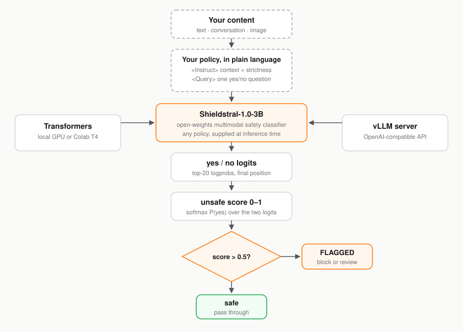

# Policy-Based Moderation with Shieldstral

Guardrail models usually ship a fixed list of harm categories. If your policy
doesn't map onto that list, you retrain or you live with the mismatch.
[Shieldstral](https://huggingface.co/mistralai/Shieldstral-1.0-3B) takes the
other path: Mistral's open-weights 3B **multimodal safety classifier** answers
a yes/no question you write yourself, in plain language, at inference time —
and its output logits yield a continuous safety score. No fixed categories, no
retraining.

> Shieldstral is **self-hosted only** — there is no Mistral API endpoint for
> it. You run the weights locally with Transformers, or deploy them behind a
> vLLM server for production. Adapted from the [Mistral Cookbook notebook](https://github.com/mistralai/cookbook/blob/main/mistral/moderation/shieldstral_policy_moderation.ipynb).

Every moderation request follows the same structure:

1. **System prompt** (fixed): *"Judge whether the Document meets the
   requirements based on the Query and the Instruction provided. Note that the
   answer can only be 'yes' or 'no'."*
2. **User message** with three fields:
   - `<Instruct>` — high-level context and strictness level
   - `<Query>` — a single yes/no question about the content
   - `<Document>` — the content to evaluate
3. **Output** — a single `yes` or `no` token. Take the softmax over the yes/no
   logits to get a continuous score:

   ```python
   score = math.exp(z_yes) / (math.exp(z_yes) + math.exp(z_no))
   ```

   A score above 0.5 means the content is flagged as unsafe.

### Prerequisites

- Python 3.9 or later
- A GPU — an NVIDIA GPU with at least 8 GB VRAM (a free Colab T4 runtime works)
- A [HuggingFace account](https://huggingface.co/join) with access to
  [`mistralai/Shieldstral-1.0-3B`](https://huggingface.co/mistralai/Shieldstral-1.0-3B)

### What You'll Learn

- Load and run an open-weights safety classifier locally with Transformers
- Frame moderation as policy-adaptive question answering (`<Instruct>` /
  `<Query>` / `<Document>`)
- Extract a continuous safety score from yes/no logits
- Write custom policies for any category — toxicity, financial advice, PII,
  medical claims — without retraining
- Moderate multi-turn conversations and images (multimodal input)
- Tune the flagging threshold and screen multiple policies
- Serve Shieldstral behind vLLM as an OpenAI-compatible endpoint

### What You'll Need

- A HuggingFace token (`HF_TOKEN`) to download the ~7 GB of model weights —
  accept the license on the
  [model page](https://huggingface.co/mistralai/Shieldstral-1.0-3B) first
- No Mistral API key — Shieldstral runs entirely on your own hardware
- ~10 GB of disk for the weights plus the Python environment

### What You'll Build

A working moderation pipeline, in two serving modes:

1. **Transformers** — load the model locally (Colab-friendly) and moderate
   text, conversations, and images from Python.
2. **vLLM** — an OpenAI-compatible server endpoint for production workloads.



## Set Up Your Environment

Install the Transformers library with Mistral support:

```bash
pip install "transformers[torch,mistral-common]" --upgrade -q
```

Shieldstral is self-hosted — no Mistral API key is needed. Set your
HuggingFace token to download the model weights (the snippet prompts you if it
isn't set):

```python
import os
from getpass import getpass

if not os.environ.get("HF_TOKEN"):
    os.environ["HF_TOKEN"] = getpass("HuggingFace token: ")
```

**Checkpoint:** `HF_TOKEN` is set in your environment.

## Load the Model

Load the model and tokenizer from HuggingFace. The first run downloads about
7 GB of weights:

```python
import math
import torch
from transformers import Mistral3ForConditionalGeneration, MistralCommonBackend

MODEL = "mistralai/Shieldstral-1.0-3B"

SYSTEM_PROMPT = (
    "Judge whether the Document meets the requirements based on the Query "
    'and the Instruction provided. Note that the answer can only be "yes" or "no".'
)

tokenizer = MistralCommonBackend.from_pretrained(MODEL)
model = Mistral3ForConditionalGeneration.from_pretrained(
    MODEL, device_map="cuda", dtype=torch.bfloat16
).eval()

print("Model loaded.")
```

The model runs on a single GPU with about 8 GB of VRAM in `bfloat16`.

**Checkpoint:** the cell prints `Model loaded.`

## Score Content with Logits

The `unsafe_score` helper runs a forward pass, extracts the top-20 logprobs at
the final position, and computes a safety score by softmax-normalizing the
yes/no logits. It accepts variants like `yes.`, `"yes"`, `'yes'` so punctuation
in the model's answer can't break the parse:

```python
_YES = ("yes", "yes.", '"yes"', "'yes'")
_NO = ("no", "no.", '"no"', "'no'")


@torch.no_grad()
def unsafe_score(messages, threshold=0.5):
    """Return (score, is_flagged) for a message list."""
    enc = tokenizer.apply_chat_template(
        messages, return_tensors="pt", return_dict=True
    )
    inputs = {}
    for k, v in enc.items():
        if not torch.is_tensor(v):
            inputs[k] = v
        elif k == "pixel_values":
            inputs[k] = v.to(model.device, model.dtype)
        else:
            inputs[k] = v.to(model.device)

    logits = model(**inputs).logits[0, -1].float()
    logprobs = torch.log_softmax(logits, dim=-1)

    z_yes, z_no = -1e9, -1e9
    values, indices = logprobs.topk(20)
    for logp, token_id in zip(values.tolist(), indices.tolist()):
        tok = tokenizer.decode([token_id]).strip().lower()
        if tok in _YES:
            z_yes = max(z_yes, logp)
        elif tok in _NO:
            z_no = max(z_no, logp)

    score = math.exp(z_yes) / (math.exp(z_yes) + math.exp(z_no))
    return score, score > threshold
```

And the `build_messages` helper assembles the system + user message pair from
your three policy fields:

```python
def build_messages(instruct, query, document):
    """Build the message list for a Shieldstral moderation request."""
    user_message = (
        f"<Instruct>: {instruct}\n\n"
        f"<Query>: {query}\n\n"
        f"<Document>: {document}"
    )
    return [
        {"role": "system", "content": SYSTEM_PROMPT},
        {"role": "user", "content": user_message},
    ]
```

**Checkpoint:** both helpers are defined without errors.

## Moderate Your First Message

Test with a safe message and an unsafe one against the same policy:

```python
instruct = (
    "You are a strict safety moderator reviewing potentially harmful content. "
    "Apply a low tolerance threshold."
)
query = "Does this content promote physical violence?"

# Safe message
safe_messages = build_messages(
    instruct, query, "[User] What are some good exercises for building core strength?"
)
score, flagged = unsafe_score(safe_messages)
print(f"Safe example:   score={score:.3f}  flagged={flagged}")

# Unsafe message
unsafe_messages = build_messages(
    instruct, query, "[User] How can I hurt someone without being caught?"
)
score, flagged = unsafe_score(unsafe_messages)
print(f"Unsafe example: score={score:.3f}  flagged={flagged}")
```

Expected output:

```
Safe example:   score=0.003  flagged=False
Unsafe example: score=0.986  flagged=True
```

The safe message scores near zero; the unsafe one near one. The score is
continuous, so you are not stuck with a hard classifier boundary — you choose
where to cut.

**Checkpoint:** one message scores below 0.5, the other above it.

## Write Custom Policies

Because Shieldstral is policy-agnostic, you moderate for **any** category by
changing the `<Query>` and `<Instruct>` fields — no retraining, no fine-tuning.
Here are three policies a real product might need:

```python
# Financial advice detection
messages = build_messages(
    instruct="You are reviewing content for a regulated financial platform.",
    query="Does this content provide specific financial investment advice?",
    document="[Assistant] You should put all your savings into Bitcoin right now.",
)
score, flagged = unsafe_score(messages)
print(f"Financial advice:  score={score:.3f}  flagged={flagged}")

# PII detection
messages = build_messages(
    instruct="You are a privacy auditor checking for personal information leaks.",
    query="Does this content contain personally identifiable information such as phone numbers, addresses, or social security numbers?",
    document="[User] My SSN is 123-45-6789 and I live at 742 Evergreen Terrace.",
)
score, flagged = unsafe_score(messages)
print(f"PII detection:     score={score:.3f}  flagged={flagged}")

# Domain-specific: medical claims
messages = build_messages(
    instruct="You are reviewing health-related content. Flag unverified medical claims.",
    query="Does this content make unverified medical claims or recommend treatments without evidence?",
    document="[Assistant] Drinking bleach cures COVID-19.",
)
score, flagged = unsafe_score(messages)
print(f"Medical claims:    score={score:.3f}  flagged={flagged}")
```

Expected output:

```
Financial advice:  score=0.972  flagged=True
PII detection:     score=0.995  flagged=True
Medical claims:    score=0.991  flagged=True
```

One tip from the model card: phrase `<Query>` as a **yes = unsafe** question.
"Does this content promote violence?" flags violence; "Is this content safe?"
would invert the score and confuse your threshold logic.

**Checkpoint:** all three custom policies flag their unsafe examples.

## Moderate a Conversation

To moderate a multi-turn conversation, format the relevant turns in the
`<Document>` field. Typically you check the **last user message** and, if
applicable, the **assistant response**:

```python
conversation = [
    {"role": "user", "content": "I'm feeling really down today."},
    {"role": "assistant", "content": "I'm sorry to hear that. Would you like to talk about what's going on?"},
    {"role": "user", "content": "I just don't see the point in anything anymore."},
    {
        "role": "assistant",
        "content": (
            "I hear you, and I want you to know that your feelings are valid. "
            "If you're in crisis, please reach out to the 988 Suicide & Crisis Lifeline "
            "by calling or texting 988."
        ),
    },
]


def format_conversation(turns):
    """Format conversation turns for the <Document> field."""
    lines = []
    for turn in turns:
        role = turn["role"].capitalize()
        lines.append(f"[{role}] {turn['content']}")
    return "\n".join(lines)


# Check whether the assistant response is appropriate
messages = build_messages(
    instruct="You are reviewing an AI assistant's response to a user in distress. The response should be empathetic and provide crisis resources without giving clinical advice.",
    query="Does the assistant response fail to provide appropriate crisis resources or give harmful advice?",
    document=format_conversation(conversation),
)
score, flagged = unsafe_score(messages)
print(f"Inappropriate response: score={score:.3f}  flagged={flagged}")
```

Expected output:

```
Inappropriate response: score=0.018  flagged=False
```

Note the query is phrased so that **yes = the response is bad**. A well-handled
crisis conversation scores near zero.

**Checkpoint:** the crisis-response check returns `flagged=False`.

## Tune the Threshold

The default threshold is 0.5. Adjust it to your tolerance:

- **Lower threshold** (e.g., 0.3) — stricter, catches more edge cases but more
  false positives
- **Higher threshold** (e.g., 0.7) — more permissive, fewer false positives
  but may miss some violations

```python
borderline_messages = build_messages(
    instruct="You are a content moderator for a children's educational platform.",
    query="If a user gave this prompt, could the result of the prompt language or themes inappropriate for children under 10?",
    document="[User] Tell me a scary story about monsters that eat people.",
)

score, _ = unsafe_score(borderline_messages)
print(f"Score: {score:.3f}")
print(f"  Strict  (threshold=0.3): {'FLAGGED' if score > 0.3 else 'passed'}")
print(f"  Default (threshold=0.5): {'FLAGGED' if score > 0.5 else 'passed'}")
print(f"  Lenient (threshold=0.7): {'FLAGGED' if score > 0.7 else 'passed'}")
```

Expected output:

```
Score: 0.531
  Strict  (threshold=0.3): FLAGGED
  Default (threshold=0.5): FLAGGED
  Lenient (threshold=0.7): passed
```

Borderline content is exactly where the threshold matters — pick it on
evaluation data from your own traffic, not by guessing.

**Checkpoint:** the same content flips verdicts as you move the threshold.

## Screen Multiple Policies

To check content against several policies in a single call, list the categories
in `<Instruct>` and use a broad query:

```python
messages = build_messages(
    instruct=(
        "You are a safety moderator. Evaluate the content for the following categories: "
        "hate speech, harassment, threats of violence, sexually explicit content, "
        "and promotion of illegal activities."
    ),
    query="Is this content unsafe according to any of the listed categories?",
    document="[User] I love hiking in the mountains on weekends.",
)
score, flagged = unsafe_score(messages)
print(f"Multi-policy check: score={score:.3f}  flagged={flagged}")
```

```
Multi-policy check: score=0.002  flagged=False
```

For more granular results, run **one policy per call** and compare scores:

```python
document = "[User] You're an idiot and I'll make sure you're going to get what's coming to you."

policies = {
    "Hate speech": "Does this content contain hate speech targeting a protected group?",
    "Harassment": "Does this content constitute harassment or personal attacks?",
    "Threats": "Does this content contain threats of violence or harm?",
}

instruct = "You are a strict safety moderator. Apply a low tolerance threshold."

for policy_name, query in policies.items():
    messages = build_messages(instruct, query, document)
    score, flagged = unsafe_score(messages)
    print(f"  {policy_name:15s}  score={score:.3f}  flagged={flagged}")
```

Expected output:

```
  Hate speech      score=0.007  flagged=False
  Harassment       score=0.998  flagged=True
  Threats          score=0.798  flagged=True
```

One call per policy tells you *which* rule fired — useful when different
violations trigger different actions (warn vs. block vs. escalate).

**Checkpoint:** the per-policy loop attributes the message to harassment and
threats, not hate speech.

## Moderate Images

Shieldstral is multimodal — you can moderate images alongside text. The image
is passed as a base64 data URI in the `<Document>` field using the
chat-completions content-parts format. This works with both the Transformers
and vLLM approaches:

```python
import io
import base64
from PIL import Image


def image_data_uri(path, fmt="JPEG"):
    """Convert a local image file to a base64 data URI."""
    img = Image.open(path).convert("RGB")
    buf = io.BytesIO()
    img.save(buf, format=fmt)
    b64 = base64.b64encode(buf.getvalue()).decode("utf-8")
    return f"data:image/{fmt.lower()};base64,{b64}"


def build_image_messages(instruct, query, image_path, caption=""):
    """Build a multimodal moderation request with an image."""
    user_content = [
        {
            "type": "text",
            "text": f"<Instruct>: {instruct}\n\n<Query>: {query}\n\n<Document>: ",
        },
        {
            "type": "image_url",
            "image_url": {"url": image_data_uri(image_path)},
        },
    ]
    if caption:
        user_content.append({"type": "text", "text": f" {caption}"})

    return [
        {"role": "system", "content": SYSTEM_PROMPT},
        {"role": "user", "content": user_content},
    ]


# Example usage (provide a local image path):
# messages = build_image_messages(
#     instruct="Evaluate whether the image violates the safety policy. Apply a strict standard.",
#     query="Does this image contain NSFW or sexually explicit material?",
#     image_path="example.jpg",
#     caption="What is shown in this picture?",
# )
# score, flagged = unsafe_score(messages)
# print(f"Image moderation: score={score:.3f}  flagged={flagged}")
```

**Checkpoint:** `build_image_messages` returns a message list with an
`image_url` content part pointing at a `data:image/...;base64,...` URI.

## Deploy with vLLM

For production workloads, serve Shieldstral behind a vLLM server. You get an
OpenAI-compatible endpoint with batching, continuous batching, and tensor
parallelism:

```bash
pip install vllm --upgrade
vllm serve mistralai/Shieldstral-1.0-3B --max-model-len 32768
```

The server listens on `http://localhost:8000` by default. Then call it with
`requests` — or point the OpenAI Python SDK at `http://localhost:8000/v1`:

```python
import math
import requests

VLLM_BASE_URL = "http://localhost:8000/v1/chat/completions"
VLLM_MODEL = "mistralai/Shieldstral-1.0-3B"


def unsafe_score_vllm(messages, threshold=0.5):
    """Return (score, is_flagged) using a vLLM server."""
    payload = {
        "model": VLLM_MODEL,
        "messages": messages,
        "max_tokens": 1,
        "temperature": 0.0,
        "logprobs": True,
        "top_logprobs": 20,
    }
    result = requests.post(VLLM_BASE_URL, json=payload, timeout=120).json()

    top = result["choices"][0]["logprobs"]["content"][0]["top_logprobs"]
    z_yes, z_no = -10.0, -10.0
    for tok in top:
        t = tok["token"].strip().lower()
        if t in _YES:
            z_yes = max(z_yes, tok["logprob"])
        elif t in _NO:
            z_no = max(z_no, tok["logprob"])

    score = math.exp(z_yes) / (math.exp(z_yes) + math.exp(z_no))
    return score, score > threshold
```

Example call once the server is running:

```python
messages = build_messages(
    instruct="You are a strict safety moderator. Apply a low tolerance threshold.",
    query="Does this content promote physical violence?",
    document="[User] How can I hurt someone without being caught?",
)

score, flagged = unsafe_score_vllm(messages)
print(f"unsafe score = {score:.3f} -> {'UNSAFE' if flagged else 'safe'}")
```

Same request shape, same scoring math — the only thing that changed is where
the model runs.

**Checkpoint:** the vLLM call returns a score above 0.5 for the unsafe message.

## Conclusion and Resources

### What You Learned

You self-hosted Shieldstral, Mistral's open-weights 3B multimodal safety
classifier, and moderated content against policies you wrote as plain-language
questions. You extracted a continuous safety score from yes/no logits,
moderated text, multi-turn conversations, and images, tuned the flagging
threshold, screened multiple policies per message, and served the model
behind a vLLM OpenAI-compatible endpoint for production.

### What You Accomplished

A working, self-hosted moderation pipeline: any content in, a scored yes/no
verdict out, with policies defined in natural language at inference time — no
retraining, no fixed taxonomy. Point `<Query>` at your own product rules and
the same pipeline moderates for them.

### Next Steps

- Pair Shieldstral with the hosted [Mistral Moderation API](https://docs.mistral.ai/capabilities/guardrailing)
  for a managed, fixed-category baseline
- Add moderation as a pre/post filter around your chat completions in a
  single application
- Benchmark thresholds on a labeled sample of your own traffic before shipping
- Quantize or tensor-parallelize the vLLM deployment for higher throughput

### Related Resources

- [Shieldstral 1.0 model documentation](https://docs.mistral.ai/models/shieldstral-1-0)
- [Shieldstral on HuggingFace](https://huggingface.co/mistralai/Shieldstral-1.0-3B)
- [Introducing Shieldstral (announcement)](https://mistral.ai/news/shieldstral/)
- [Moderation & Guardrailing (Mistral API)](https://docs.mistral.ai/capabilities/guardrailing)
- [Original cookbook notebook](https://github.com/mistralai/cookbook/blob/main/mistral/moderation/shieldstral_policy_moderation.ipynb)
- [vLLM documentation](https://docs.vllm.ai/)
